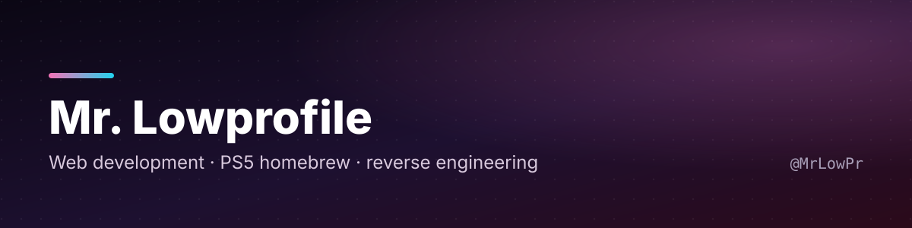
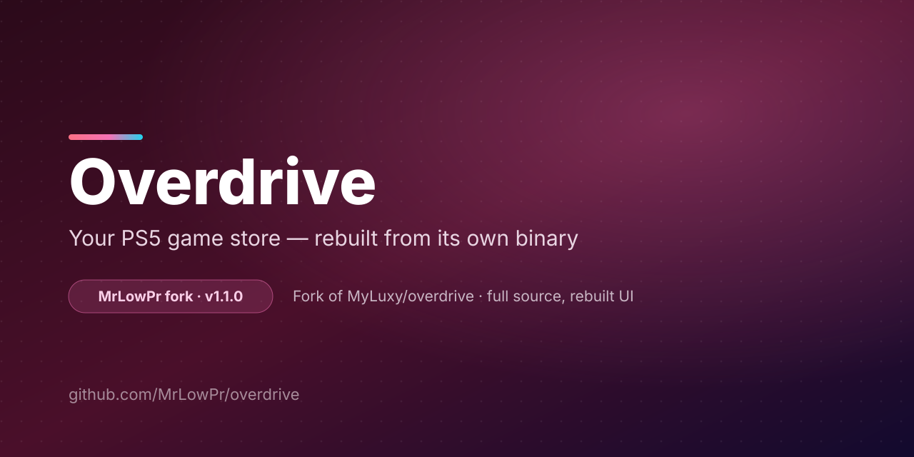

<h1 align="center">Mr. Lowprofile</h1>

  <strong>Java · Python · Docker</strong> 
  Backend developer, and reverse engineer.

  
  
  
  
  

  
  

---

## What I work with

<table>
  <tr>
    <td width="33%" valign="top">
      <b>☕ Java</b>  
      Backend services and desktop tooling.  
      Java 8–21 · OOP · Generics · Streams · Collections 
      Concurrency · <code>CompletableFuture</code> · Executor 
      Spring Boot · Spring MVC · Spring Data JPA 
      Hibernate · Jakarta EE 
      Maven · Gradle · JUnit 5 · Mockito 
      JDBC · PostgreSQL · MySQL
    </td>
    <td width="33%" valign="top">
      <b>🐍 Python</b>  
      Automation, analysis, and small services.  
      Python 3.10+ · Type hints · Decorators 
      Generators · Context managers · <code>asyncio</code> 
      FastAPI · Flask · Requests · httpx · Pydantic 
      SQLAlchemy · Pandas · NumPy 
      pytest · Logging · CLI tooling 
      Web scraping · Data cleaning
    </td>
    <td width="33%" valign="top">
      <b>🔬 Reverse engineering</b>  
      My main focus — making closed software readable.  
      Static &amp; dynamic analysis 
      Native binaries · APK · desktop apps 
      Bundle and archive inspection 
      Decompilation · protocol reading 
      Behaviour tracing · code recovery 
      Rebuilding apps so they can be modified
    </td>
  </tr>
</table>

### Docker

Containerising what I build: multi-stage Java builds, Python environments, reproducible tool runs.

---

## 📌 Featured work — Overdrive (fork)

### A PS5 homebrew game store — **1,800+ titles** — rebuilt from its own compiled bundle

A working store front that shipped only as compiled output — no readable source. I recovered the
source from the bundle, rebuilt the interface as React + esbuild, and now maintain it as a fork of
the original project.

<table>
  <tr>
    <td width="140" valign="top"><b>Problem</b></td>
    <td valign="top">1,800+ games in a working app that shipped as compiled output only — unmaintainable and impossible to change.</td>
  </tr>
  <tr>
    <td valign="top"><b>Approach</b></td>
    <td valign="top">Bundle analysis → source recovery → static analysis of the compiled app → reimplementation in a maintainable stack → documented fork.</td>
  </tr>
  <tr>
    <td valign="top"><b>Result</b></td>
    <td valign="top">Readable, buildable source again. Browse, search, queue downloads, install and update games from the console UI — no PC required.</td>
  </tr>
  <tr>
    <td valign="top"><b>Engineering</b></td>
    <td valign="top">Focus-driven controller navigation · 15 interface languages · RTL-aware layout · resumable download queue across multiple providers.</td>
  </tr>
  <tr>
    <td valign="top"><b>My role</b></td>
    <td valign="top">Fork owner and maintainer — source recovery, interface rewrite, localisation, download queue, upstream sync.</td>
  </tr>
  <tr>
    <td valign="top"><b>License</b></td>
    <td valign="top">MIT</td>
  </tr>
  </table>

  <a href="https://github.com/MrLowPr/overdrive"><b>Source code</b></a> &nbsp;·&nbsp;
  <a href="https://github.com/MrLowPr/overdrive/releases/tag/v1.1.0"><b>Release v1.1.0</b></a> &nbsp;·&nbsp;
  <a href="https://github.com/MrLowPr/overdrive/blob/main/FORK-NOTES.md"><b>Fork notes</b></a>

Maintained as a fork of [MyLuxy/overdrive](https://github.com/MyLuxy/overdrive). Every fork-specific
change is listed in [FORK-NOTES.md](https://github.com/MrLowPr/overdrive/blob/main/FORK-NOTES.md).

---

## Other work

- **[SandiGenerate](https://github.com/MrLowPr/SandiGenerate)** — password generator and strength tester running on `crypto.getRandomValues` (CSPRNG) instead of `Math.random`, so the output is not guessable.
- **[MrLowPr/overdrive](https://github.com/MrLowPr/overdrive)** — the Overdrive fork, with source recovered and every fork-specific delta documented.
- **43 repositories** of backend services, Python tooling, utilities and reverse-engineering work.

---

## Currently

- Working mostly in **Java** and **Python**, deployed with **Docker**.
- Spending most of my time on **reverse engineering**.
- **Open to work** — Java/Python backend, tooling, or reverse-engineering tasks. Remote-friendly, contract or full-time.

## Contact

- GitHub — [@MrLowPr](https://github.com/MrLowPr)
- Email — **mrlowpr@protonmail.com**

  Hand-written Markdown, no trackers, no build step.

